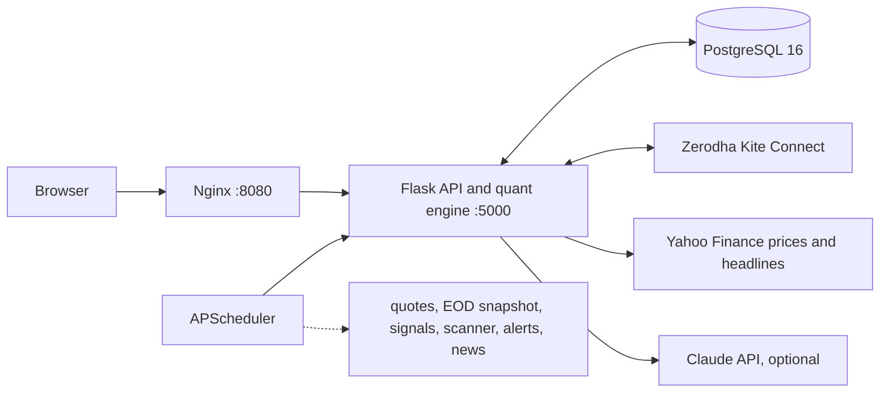

<div align="center">

# PortfolioIQ

**Your Indian equity portfolio, analysed on your own machine.**
Tax-aware rebalancing, tested signals and a market scanner, with every claim measured and every order guarded.

[](https://github.com/4LPH7/PortfolioIQ/actions/workflows/ci.yml)


[](https://github.com/astral-sh/ruff)

[Quick start](#quick-start) · [Full reference](docs/REFERENCE.md) · [What's inside](#whats-inside) · [How it decides](#how-it-decides) · [Safety](#safety) · [Configuration](#configuration) · [Development](#development)

</div>

---

PortfolioIQ is for NSE and BSE investors who want more than a P&L screen. It runs entirely in Docker on your computer, so your Zerodha token, holdings, tax lots and trade history never leave it. Nothing is hosted, nothing phones home.

Four ideas shape it:

| | |
|---|---|
| **Private** | One command starts Postgres, the API and the web app locally. No cloud account. |
| **Evidence first** | A signal is used only if it held up out of sample, after Indian delivery charges. The app says plainly when something has *no* tested edge. |
| **Safe by default** | Orders are simulated until you turn that off yourself, and every real order passes seven pre-trade checks. |
| **Advisory AI** | The optional Claude research committee writes text for you to read. It has no tools and no path to an order. |

## Quick start

You need [Docker Desktop](https://www.docker.com/products/docker-desktop/) running and Python 3.10+ for the launcher.

```bash
python run.py
```

The first run creates `.env` with a random unlock key, builds the containers, applies the database migrations, waits for the API to be healthy, prints your key and opens the dashboard at **http://localhost:8080**.

1. Enter the **unlock key** (printed by `run.py`, stored as `PORTFOLIOIQ_API_KEY` in `.env`).
2. Open **Onboarding** and import a holdings CSV from your broker. No Zerodha account is needed; an `LTP` column sets current prices. Or connect Kite for live quotes ([below](#connect-zerodha-kite)).
3. Orders stay simulated until you set `DRY_RUN_MODE=false`. Read [`docs/GRADUATION_CHECKLIST.md`](docs/GRADUATION_CHECKLIST.md) first.

<details>
<summary><b>Launcher options, URLs and troubleshooting</b></summary>

| Command | What it does |
| :-- | :-- |
| `python run.py` | Build, start, open the browser, stream logs |
| `python run.py -d` | Start in the background and exit |
| `python run.py --no-browser` | Start without opening a browser |
| `python run.py --status` | Show container states and probe the API and UI |
| `python run.py --stop` | Stop and remove the containers (data stays in the `pgdata` volume) |
| `python run.py --local` | Run natively without Docker |

Shortcuts: `start.bat` (Windows), `./start.sh` (macOS/Linux), `docker compose up --build`.

| Service | URL |
| :-- | :-- |
| Web app | http://localhost:8080 |
| API and UI from Flask | http://localhost:5000 |
| Health check | http://localhost:5000/api/v1/health |
| pgAdmin (optional, localhost only) | http://localhost:5050, via `docker compose --profile tools up -d` |
| Postgres | `127.0.0.1:5434` (change with `POSTGRES_PORT`) |

| Symptom | Fix |
| :-- | :-- |
| `Docker is installed but not running` | Start Docker Desktop, wait until it says running, run `python run.py` again. |
| Port 5000 or 8080 in use | Stop the other app, or change the host port in `docker-compose.yml`. |
| Forgot the unlock key | It is `PORTFOLIOIQ_API_KEY` in `.env`, and `run.py` prints it on every start. |
| Backend restarts in a loop | A migration failed. `docker compose logs backend` shows which one; the app refuses to start on a half-migrated database. |
| Market shown as open on a holiday | The bundled NSE holiday calendar ends in 2026. Add the next year as a migration when NSE publishes it. |

</details>

## What's inside

| Page | What you get |
| :-- | :-- |
| **Dashboard** | Net worth, P&L, allocation, live prices, headlines for your holdings, and notification-bell alerts. |
| **Stock Analyzer** | Evidence-gated signals (RSI, MACD, Bollinger, momentum) weighted by their out-of-sample record, calibrated Monte Carlo cones, **stop and target odds** from 10,000 replays of a stock's own history, **price alerts**, and the optional **AI research committee**. |
| **Market Scanner** | The NIFTY 500 ranked each weekday on price signals that passed an out-of-sample test, with the backtest of the top 20 after charges, the stocks left out and why, and fundamentals and headline counts for context. |
| **Rebalance** | Drift against your targets, CNC order proposals with Indian statutory costs, and **suggested targets** (risk parity, minimum variance, hierarchical risk parity, equal weight) checked by a walk-forward test. Suggestions are saved inactive and drive drift only after you activate them. |
| **Tax Guard** | FIFO tax lots, STCG 20% and LTCG 12.5% above the ₹1.25 lakh exemption, 30-day long-term warnings and loss-harvesting proposals. |
| **Timeline** | Time-weighted return against NIFTY 50 TRI, event markers, and a 1 to 10-year **projection** of the whole portfolio. |
| **Monthly Report** | A printable statement: Sharpe, Sortino, probabilistic Sharpe, VaR and CVaR, drawdown, alpha, beta and cost attribution. |
| **Audit Log** | An append-only record of every order idea, every pre-trade check and every broker response, exportable as CSV. |
| **Status, Settings, Onboarding** | Health and market clock, runtime limits and safeguards, and a guided first run. |

## How it decides

PortfolioIQ does not predict prices. It measures whether an idea has paid before, and shows the result next to the idea.

- **Out of sample.** Signals are scored on data they never saw, using rank correlation (IC) with the returns that followed. A signal with no significant positive record gets weight zero.
- **After costs.** Backtests charge Indian delivery costs (STT, exchange and SEBI fees, stamp duty, GST, DP charges) plus slippage. The signal backtest also fills at the next session's open and adds a volume-based market-impact cost.
- **Honest verdicts.** The scanner leads with **tested edge** or **no tested edge**, says when the record is short, and notes that testing on today's index members flatters the past.
- **Bad data stays out.** A shared check drops stocks with thin history, stale prices, gaps or a frozen price, and lists each one with its reason.
- **Reproducible.** Simulations print their seed, and backtest runs are fingerprinted with a hash of their inputs.

Not included, on purpose: intraday trading tools, anything that places an order from an AI output, and any promise of future returns.

## Safety

Real orders pass these checks in order, and each result is written to the audit log: market hours, margin, **sellable quantity** (including T+1 and open sell orders), **circuit price band**, slippage, concentration limit and duplicate window.

- **Dry run first.** `DRY_RUN_MODE=true` is the default and the global kill switch. When live data needed for a check is missing, a live order is rejected rather than guessed.
- **Alerts are not orders.** Price alerts, risk guards and news only notify you.
- **AI is advisory.** The research committee has a hard per-run cost cap, a daily limit, and checks that every number it cites matches the data it was given.
- **No secrets in the repo.** Keys live in `.env`; CI scans history with Gitleaks and audits dependencies.

## How it fits together



The scheduler runs inside the API process: start-of-day sync, live quote polling in market hours, an end-of-day snapshot, signal settlement, the nightly scanner, price-alert checks and headline refreshes. All schema changes are numbered SQL migrations in `db/migrations`, applied at startup and checksummed, so an applied migration is never edited.

## Configuration

Copy `.env.example` to `.env` (the launcher does this for you).

<details>
<summary><b>Environment variables</b></summary>

| Variable | Default | Purpose |
| :-- | :-- | :-- |
| `PORTFOLIOIQ_API_KEY` | generated on first run | Dashboard unlock key, sent as the `X-API-Key` header |
| `DRY_RUN_MODE` | `true` | When `true`, every order is simulated |
| `KITE_API_KEY`, `KITE_API_SECRET` | empty | Zerodha Kite Connect credentials (optional with CSV import) |
| `KITE_REDIRECT_URL` | `http://127.0.0.1:5000/api/v1/broker/callback` | Must match your Kite app |
| `ANTHROPIC_API_KEY` | empty | Turns on the research committee |
| `DATABASE_URL` | set by Docker | PostgreSQL connection string |
| `ALLOWED_ORIGINS`, `FRONTEND_ORIGIN` | localhost | Browser origins allowed to call the API |
| `POLLING_INTERVAL_SEC` | `15` | Minimum gap between Kite quote requests |
| `SLIPPAGE_BOUND_PCT` | `2.0` | Block an order when price drifts further than this |
| `CONCENTRATION_LIMIT_PCT` | `15.0` | Largest single-stock weight |
| `DUPLICATE_WINDOW_SEC` | `300` | Window for blocking duplicate orders |
| `LOG_LEVEL`, `APP_ENV`, `TIMEZONE` | `INFO`, `development`, `Asia/Kolkata` | Logging and scheduling |

More limits (risk alerts, price-band age, research cost cap and daily runs, models) are editable under **Settings**.

</details>

### Connect Zerodha Kite

1. In the [Kite developer console](https://developers.kite.trade/apps) create an app and set its redirect URL to `http://127.0.0.1:5000/api/v1/broker/callback`.
2. Put `KITE_API_KEY` and `KITE_API_SECRET` in `.env` and restart.
3. Each day, open **Settings → Broker connection** and sign in with Zerodha. Holdings, margins and positions sync into your local database.

### Turn on the AI research committee (optional)

Add `ANTHROPIC_API_KEY` to `.env` and restart. On the Analyzer page, **Ask the committee** runs six analysts, a two-round bull and bear debate and a portfolio manager on one stock. It asks you to confirm each run, which is capped at $1.00 by default (change it in Settings), and each rating is later scored against what the stock did.

## Development

```bash
pip install -r requirements-dev.txt

pytest tests/                                  # full suite; needs the local Postgres for database tests
ruff check . && ruff format --check .          # lint and format
pytest tests/ --cov=src --cov-report=json:coverage.json
python scripts/check_critical_coverage.py --coverage-file coverage.json   # 85% floor on order guards
```

CI runs lint, the dependency audit, the Docker build, the migrations and the tests on every push. Database tests use a separate `<name>_test` database and roll back, so they never touch your portfolio data.

<details>
<summary><b>Dependency audit note</b></summary>

`pip-audit` runs with a short ignore list for `twisted`, which arrives through `kiteconnect` for its websocket client. PortfolioIQ uses only the REST client and never imports it. Each ignore is justified in `.github/workflows/ci.yml`; remove them once a fixed `twisted` release ships.

</details>

## Disclaimer

PortfolioIQ is a personal research and paper-trading tool. Signals, simulations and AI output are statistical descriptions of past data, not advice, and none of them guarantees future returns. Most active traders lose money. Never risk capital you cannot afford to lose.
